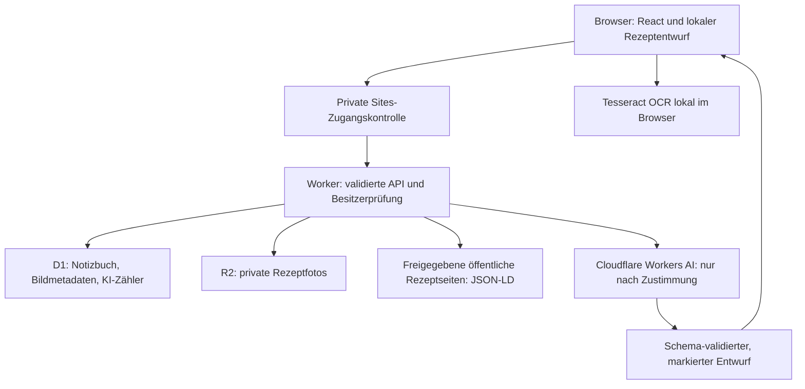

# My Cookbook: Architektur und MVP-Entscheidungen

Stand: 2026-10-01. Codebasis: GitHub main, Commit 7d8a975. Diese Bestandsaufnahme prüft Quellcode und vorhandene Prüfnachweise; sie ist kein neuer Live-Security-Audit. Änderungen in diesem Dokument verändern weder App noch Infrastruktur. Verantwortungsbereich: Technik; Business Value und Feature-Priorisierung durch Product & Growth Lead.

## 1. Architektur und Datenfluss

My Cookbook ist ein privater modularer Monolith: Browseroberfläche und API gehören zu einer Anwendung. Es gibt keine separaten Microservices, Warteschlange oder Vektordatenbank.

Importe erzeugen bearbeitbare Entwürfe. Erst bewusstes Speichern schreibt das Notizbuch. OCR-Auswertung, gespeichertes Rezeptfoto und Bildübermittlung an KI sind unterschiedliche Vorgänge. Quellen und Originalimporte können im gespeicherten Rezept verbleiben.

## 2. Tech-Stack und Komponenten

| Ebene | Bestehende Umsetzung | Verantwortung / Konsequenz |
|---|---|---|
| Sprache | TypeScript 5.9.3 | Gemeinsame Typen, zusätzliche Laufzeitvalidierung nötig |
| Oberfläche | React 19.2.6, Next 16.3.6 API-Konventionen, Tailwind 4.2.1, UI-Komponenten | `app/cookbook.tsx`, Editor, Importer und KI-Panel; große Cookbook-Komponente ist Wartbarkeitsschuld |
| Tatsächlicher Build | Vite 8.0.13 und vinext 1.0.0-beta.5, Cloudflare Vite Plugin | Next-kompatible Anwendung auf Workers; kein gewöhnliches Next/Vercel-Deployment. Beta-Adapter erzeugt Plattform-/Upgrade-Risiko |
| Datenvalidierung | Zod 3.25.76 | `lib/model.ts`, Import- und KI-Schemas; Fremddaten bleiben untrusted |
| Speicherung | Cloudflare D1 (SQLite), R2 | `lib/storage.ts`, `db/schema.ts`, SQL-Migrationen; Drizzle definiert Schema, produktive Repository-Abfragen verwenden vorbereitete SQL-Statements |
| OCR | Tesseract.js 6.0.1, lokale Worker/WASM/Sprachdateien | Browserauswertung ohne externen OCR-Dienst; DE/EN/FA-Pakete vorhanden, persische Bilderkennung derzeit zurückgestellt |
| Zutatenlogik | `lib/ingredients.ts`, `lib/units.ts`, `lib/model.ts` | Deterministische Extraktion, Einheiten-Aliase, Mengenbereiche, Skalierung, Vorratsabgleich und Einkaufsliste |
| KI | `lib/recipe-ai.ts`, `lib/cloudflare-ai.ts` | Prompt, Provideradapter, Ergebnisvalidierung und Prüfmarkierungen |
| Werkzeugkette | Node 24 in CI, pnpm 11.25.0 | Lockfile, Tests, Typprüfung, Build; deklarierte Node-Untergrenze ist 22.13 |
| Betrieb | Private Sites, Cloudflare Worker, GitHub | GitHub speichert Code und führt CI aus; Sites-Veröffentlichung ist ein eigener Schritt |

## 3. Datenmodell

| Tabelle | Felder | Zweck |
|---|---|---|
| `notebooks` | `owner` Primärschlüssel, `payload`, `version`, `updated_at` | Ein JSON-Notizbuch je Besitzer. Version dient als optimistische Sperre |
| `attachments` | `id`, `owner`, `object_key`, `mime`, `size` | Besitzerzuordnung zum R2-Objekt; Foto selbst liegt nicht in D1 |
| `ai_usage` | `day` Primärschlüssel, `requests` | Globaler Tageszähler der Anwendung, nicht je Nutzer |

Notizbuch: Rezepte, Vorrat, Tags, benutzerdefinierte Zutaten-Aliase und Einkaufsliste. Ein Rezept enthält Titel und optionale Übersetzungstitel, Sprache, Beschreibung, Kategorie, Küche, Portionen/Einheit, Vorbereitungs-/Koch-/Ruhe-/Gesamtzeit, Zutaten, Schritte, Tags, Notizen, Quelle, Quelltext, Originalimport, Bildreferenz, Favorit-/Gekocht-Status, Kochhistorie und bis zu 30 Revisionen.

Zutat: Name, `quantity` als Zahl oder null, alternativ `quantityRange:{min,max}`, Einheit, optional und Notiz. Bereiche haben `quantity:null`; unbekannte Mengen werden nicht erfunden. Bekannte Einheiten werden normalisiert; Volumen wird nicht ohne belastbare Dichte in Masse umgerechnet. DE/EN/FA-Zutatenabgleich nutzt ein begrenztes Wörterbuch und eigene Aliase, keine semantische Suche.

KI-Markierungen: pro Feld `origin` (extracted/estimated), `status` (unreviewed/accepted/verified/edited), Begründung und ursprünglicher Wert. Zutaten und Schritte sind jeweils als Gruppe markiert, nicht pro Einzelwert. Zeiten und Portionen werden vorsichtshalber auch bei vermeintlicher Extraktion als estimated gekennzeichnet. Das ist eine konservative Kennzeichnung, kein Beweis, dass der Wert tatsächlich geschätzt wurde.

Grenzen: 500 Rezepte im Schema, aber der gesamte Schreibrequest ist auf 1 MiB begrenzt; 500 umfangreiche Rezepte mit Revisionen passen daher nicht zwingend. Fotos maximal 600 pro Besitzer und 2 MiB pro Upload. Backup: Schema-Version 1, unverschlüsseltes JSON mit Base64-Fotos, höchstens 14 MiB Foto-Rohdaten beim Export und 20 MiB Importdatei. Base64 und JSON-Formatierung erhöhen den Exportumfang; ein Export nahe der Grenze ist nicht automatisch wieder importierbar. Foto-ID-Neuzuordnung bei Wiederherstellung ist implementiert, der vollständige Browser/R2-Roundtrip ist noch nicht nachgewiesen.

## 4. API-Verträge

| Route | Verhalten | Wesentliche Begrenzung |
|---|---|---|
| GET `/api/state` | Notizbuch und Version des Besitzers | Private, nicht cachebare Antwort |
| POST `/api/state` | Validiertes vollständiges Notizbuch schreiben | Besitzerprüfung aller Fotos, 1 MiB, 409 bei Versionskonflikt |
| POST `/api/images` | Foto nach R2, Metadaten nach D1 | JPEG/PNG/WebP-Signatur und MIME, 2 MiB, 600-Foto-Grenze |
| GET `/api/images/:id` | Privates Foto lesen | ID und Besitzer prüfen, nosniff/no-store |
| POST `/api/recipe-link` | Öffentliche Seite abrufen und Recipe-JSON-LD lesen | 20 erlaubte Publisher, HTTPS, geprüfte Redirects, 15 s, 2 MB |
| GET `/api/recipe-ai` | Konfiguration und Tageskontingent anzeigen | Verbraucht keine Modellanfrage |
| POST `/api/recipe-ai` | Text/Bild an Cloudflare, validierter Entwurf zurück | Zustimmung, DE/EN-Ausgabe, 18.000 Textzeichen, JPEG bis 2 MB, 45 s |

Alle APIs verlangen Plattformidentität; Schreib-/Importrequests verlangen zusätzlich den exakten eigenen Origin. Keine offene CORS-Freigabe. Typische Fehler: 401/403 Zugang, 409 Speicher-Konflikt, 413 Größenlimit, 429 KI-Limit, 422 Import-/KI-Auswertung, 502 Provider-Ablehnung, 503 Nichtverfügbarkeit. Die KI-Route fasst einige Validierungs-/Timeout-/Serverfehler derzeit unter 422 zusammen; genauere sichere Fehlercodes sind offen.

## 5. Externe Services und Kostenmodell

- **Sites / ChatGPT-Zugang:** private Veröffentlichung, vorgelagerte Authentifizierung und Deployment. Portierung benötigt einen neuen vertrauenswürdigen Auth-Adapter.
- **Cloudflare D1/R2/Worker:** bestehende Laufzeit und Datenspeicher. Hosting-/Speicherabrechnung ist getrennt vom KI-Kontingent; aktuelle Tarife wurden für diese Codebestandsaufnahme nicht neu verifiziert.
- **Cloudflare Workers AI:** konfiguriertes Modell `@cf/google/gemma-4-26b-a4b-it`. Rezepttext oder ausgewählte Bilder verlassen nach expliziter Zustimmung die App. Token bleibt serverseitig; Konfiguration über `CF_AI_ACCOUNT_ID`, `CF_AI_TOKEN`, `CF_AI_FREE_ONLY_CONFIRMED`.
- **Rezept-Publisher:** erhalten serverseitige Seitenabrufe, einschließlich eingegebener URL/Query. Keine Nutzer-Cookies oder Anmeldedaten werden absichtlich weitergegeben. URL-Import verwendet keine KI und übersetzt nicht automatisch den Seiteninhalt.
- **GitHub:** privates Repository, Pull Requests und CI. Keine produktiven Rezepte oder Secrets gehören ins Repository.

Die App reserviert atomar maximal fünf KI-Aufrufe pro UTC-Tag, zählt Fehlschläge mit und nutzt keine automatische Wiederholung oder bezahlte Ausweichlösung. Die Free-only-Variable dokumentiert eine bestätigte Konfiguration; sie prüft weder Provider-Abrechnung noch Kontoverbrauch. Andere Anwendungen desselben Cloudflare-Kontos können ebenfalls Kontingent nutzen. **Fünf Anfragen sind keine Euro-Kostenobergrenze.** Vor Änderung des Modells, Aktivierung kostenpflichtiger Nutzung oder öffentlicher Freigabe müssen tatsächliche Provider-Einstellungen, Tarife, Aufbewahrung und Verarbeitungsbedingungen separat geprüft werden. Hier wurde kein neuer Dienst angeschlossen.

## 6. Security und Privacy: umgesetzt vs. offen

Umgesetzt: Plattformidentität und Besitzerbindung; vorbereitete SQL-Abfragen; Same-Origin-Prüfung bei POST; streambasierte Größenlimits; strenge Zod-Schemas; private Antworten/Fotolesen; React-Textausgabe statt fremdem HTML; private R2-Schlüssel; HTTPS-Publisher-Allowlist auch nach Redirects; serverseitige Secrets; überprüfbare KI-Entwürfe mit Zustimmung.

| Risiko / offene Nachweise | Bedeutung | MVP-Maßnahme |
|---|---|---|
| Identitätsheader vertrauen dem Sites-Dispatcher | Direkte öffentliche Worker-Freigabe wäre gefährlich | Private Plattformgrenze beibehalten; echten Zugriff ohne Login und fremden Besitzer separat testen |
| Verwaiste Fotos / fehlende Lösch-API | Rezeptlöschen entfernt nicht zuverlässig R2-Daten; Wiederherstellungen erzeugen neue Bilder | Sichere referenzbasierte Bereinigung einschließlich Revisionen und dokumentierter Löschweg |
| Backupgrenzen und Wiederherstellung | Export nahe Größenlimit kann nicht importierbar sein; Teilfehler lassen Fotos zurück | Vollständigen Roundtrip mit Fotos, Limits und Konfliktfällen testen; Grenze anhand tatsächlicher Exportbytes sichern |
| Bildprüfung nur MIME/Signatur serverseitig | Kein vollständiger Decoder; Clientlimits sind umgehbar, Pixelprüfung erfolgt nach Browserdecode | Für private MVP begrenzen und testen; serverseitiges Re-Encoding vor öffentlichem Upload neu bewerten |
| Kein allgemeines App-Rate-Limit | Upload-/Linkrequests sind nicht durch KI-Limit geschützt; Fotolimit Count-then-insert ist bei Parallelität nicht atomar | Vor weiterer Freigabe einfache Plattform-/Routenlimits und atomare Quoten prüfen |
| KI-Fakten und Prompt Injection | Schema garantiert Form, nicht richtige Zutaten oder Zeiten; Prompt ist keine Sicherheitsbarriere | Keine KI-Tools mit Schreibrechten; Entwurf menschlich prüfen; Grenzfälle testen |
| Datenübermittlung an Cloudflare | Fotos können Namen/Metadaten enthalten, Text kann private Angaben enthalten | Zustimmung beibehalten, Bildauswahl zuschneiden, keine sensiblen Daten; Provider-Aufbewahrung/Regionen noch verifizieren |
| Wenig Betriebsdiagnostik | Generische Fehler sind sicherer, aber schwer zuzuordnen | Inhaltsfreie Fehlercodes, Request-ID, Latenz und Status; keine Tokens, Bilder, Rezepttexte oder kompletten URLs loggen |
| Adapter-/Abhängigkeitsrisiko | vinext Beta und zahlreiche UI-Abhängigkeiten | Lockfile behalten, gezielte Updates mit CI; keine ungenutzten Dienste ergänzen |
| Kein Nachweis vollständiger App-CSP / unabhängiger Audit | Foto-CSP existiert, kein umfassender App-Nachweis | CSP-Kompatibilität gesondert prüfen; vorhandene Tests nicht als Security-Zertifizierung bezeichnen |

Backups sind nicht verschlüsselt. TLS/private Zugangskontrolle sind keine Ende-zu-Ende-Verschlüsselung. Kein Nachweis garantiert Datenresidenz, Löschfristen beim Provider oder vollständige Datenschutz-Compliance. Vor öffentlicher Mehrnutzerfreigabe muss Product & Growth Lead deren Bedarf klären; danach technische und gegebenenfalls rechtliche Prüfung.

## 7. Testing, Betrieb und Git

Bestehende Nachweise: 84 Tests sowie Typprüfung und Build erfolgreich im letzten Feature-PR. Tests betreffen Domainlogik, Import, KI-Antwortverträge, Einheiten, SQL-basierte Besitzertrennung/Versionskonflikte, Persistenz und Quota. Kein neuer Modellaufruf für diese Dokumentation. Browser-End-to-End, reale Auth-Dispatcher-Abweisung und vollständige R2-Backupwiederherstellung sind nicht durch diese Tests belegt. Nutzer meldete einen erfolgreichen ersten Praxistest.

GitHub Actions prüft Pull Requests und main mit Node 24, Lockfile und SHA-gepinnten Actions; 15-Minuten-Limit und minimale Leserechte. Branch Protection mit verpflichtenden Checks ist noch nicht eingerichtet. Sites-Deployment erfolgt gesondert: erfolgreicher Build/PR bedeutet nicht automatisch neue Produktion. Quellcodeversionen können zurückgerollt werden; Datenbankmigrationen verlangen eigene Rückwärtskompatibilität und Sicherung. Es besteht kein nachgewiesener Alarmierungs-/Disaster-Recovery-Prozess.

## 8. Architekturentscheidungen und offene Optionen

| Entscheidung | Optionen und Abwägung | Empfehlung / späterer Wechselgrund |
|---|---|---|
| Persistenz | Browser-only: billig, kein geräteübergreifendes Speichern. JSON-D1: einfach/atomar, Größenlimit und accountweite Konflikte. Einzelne Rezepttabellen: bessere Teilupdates/Suche, mehr Migrationen | JSON-D1 jetzt behalten; erst bei realem Größen-/Konfliktproblem normalisieren. Dann Schema-Versionierung und Migration planen |
| Auth | Sites-Identität: bereits vorhanden, Plattformbindung. Eigener Auth-Anbieter: portabel, zusätzlicher Dienst und Betrieb | Bestehenden Auth-Adapter behalten; bei Hostwechsel vor Freigabe ersetzen, keine eigenen Passwörter |
| Extraktion | Deterministischer Text/JSON-LD-Import: günstig, begrenzt. Browser-OCR: lokal, weniger genau. Optional KI: flexibler, Drittanbieter und Kosten | Alle bestehenden Wege behalten; KI bleibt optional, mit einem Provider und manueller Prüfung |
| Mehrsprachigkeit | Direkte DE/EN-Texte: einfach, bei Wachstum schwerer wartbar. i18n-Katalog: zentraler, Refactoring | DE/EN-UI und vorhandenes FA-Datenmodell behalten. i18n-Katalog bei nächster relevanter UI-Erweiterung; FA-Bilder nicht neu priorisieren |
| Kostenkontrolle | Requestzahl: einfach, aber kein Budgetbeweis. Providergrenzen: kontoweit. Eigener Token-/Kostenledger: Zusatzaufwand und Modellabhängigkeit | Free-only-Betrieb im Konto verifizieren, 5/Tag behalten; keinen eigenen Abrechnungsdienst bauen |
| Monitoring | Keine eigenen Logs: wenig Daten, schwache Diagnose. Reduzierte Metadatenlogs: hilfreich. Externe Observability-Plattform: Zusatzdienst | Wenige bereinigte Metadaten über bestehende Plattform, keine neue Plattform |
| Fotos löschen | Sofortige Löschung: gefährdet Revisionen. Referenzbasierte Bereinigung: sicherer, braucht Scan/Frist | Erst referenzbasierte manuelle/admin Bereinigung; Cronjobs erst bei tatsächlichem Bedarf |

## 9. Wirklich nötiges MVP

**Beibehalten:** privater Zugang, Rezept erstellen/bearbeiten/löschen, belastbares Speichern mit Konflikthinweis, Mengen und Bereiche, Suche/Vorrat/Einkaufsliste soweit vorhanden, DE/EN-Ausgabe, Quellen, prüfbare KI-Felder, manueller/Text-/JSON-LD-Import, optionaler begrenzter KI-Import und Backup.

**Vor verlässlicher regelmäßiger Nutzung absichern:** (1) Foto-Backup samt Restore und tatsächlichen Größenlimits, (2) klare Foto-/Datenlöschung, (3) Live-Zugriffsschutz, (4) Kosten-/Providerkonfiguration, (5) Importfehler und mobile Bedienung, (6) minimale inhaltsfreie Fehlerdiagnostik. Tests mit synthetischen Daten und isolierter Testdatenbank, keine echten Rezepte überschreiben.

**Vorerst nicht hinzufügen:** eigene Passwortverwaltung, Microservices, Kubernetes, Queue, Vektordatenbank, mehrere KI-Anbieter, automatische Veröffentlichung von KI-Ergebnissen, beliebiger Webcrawler, persische Bilderkennung oder umfangreiche Analytics. Bedarf und Business Value neuer Features beurteilt Product & Growth Lead.

Grobe Aufwandsklassen, keine Terminzusage: Backup-/Grenzfalltest mittel; Auth-Liveprüfung klein bis mittel abhängig vom Plattformzugriff; Foto-Bereinigung mittel; reduzierte Fehlerdiagnostik klein bis mittel; Datenmodellmigration groß und derzeit nicht gerechtfertigt.

## 10. Erklärung für Portfolio und Bewerbung

„My Cookbook ist eine private Full-Stack-Rezeptanwendung auf einer Worker-Laufzeit. Strukturierte Rezeptdaten werden als versioniertes Besitzer-Dokument in D1 gespeichert, Fotos separat in R2. Importdaten werden vor der Übernahme validiert. Deterministische Einheitenverarbeitung bewahrt Mengenbereiche; optionale KI liefert prüfbare Entwürfe und gekennzeichnete Schätzungen. Die Plattform übernimmt die Anmeldung, während APIs jede Ressource an den Besitzer binden. CI prüft Tests, Typen und Build. Für das MVP habe ich bewusst eine einfache Architektur gewählt und ihre Grenzen dokumentiert.“

Nur tatsächlich nachgewiesene Fähigkeiten nennen. KI-Unterstützung und eigener Beitrag transparent erklären; vollständige Security-Audits, Produktionstests oder Skalierungsnachweise nicht behaupten.

## Quellcode als Nachweis

`package.json`, `vite.config.ts`, `.openai/hosting.json`, `db/schema.ts`, `lib/model.ts`, `lib/storage.ts`, `lib/server.ts`, `app/chatgpt-auth.ts`, `lib/ingredients.ts`, `lib/units.ts`, `lib/web-recipe.ts`, `lib/recipe-ai.ts`, `lib/cloudflare-ai.ts`, `lib/ai-quota.ts`, `app/api/*`, `app/cookbook.tsx`, `app/recipe-ai-panel.tsx`, `.github/workflows/check.yml`, `tests/*`.
