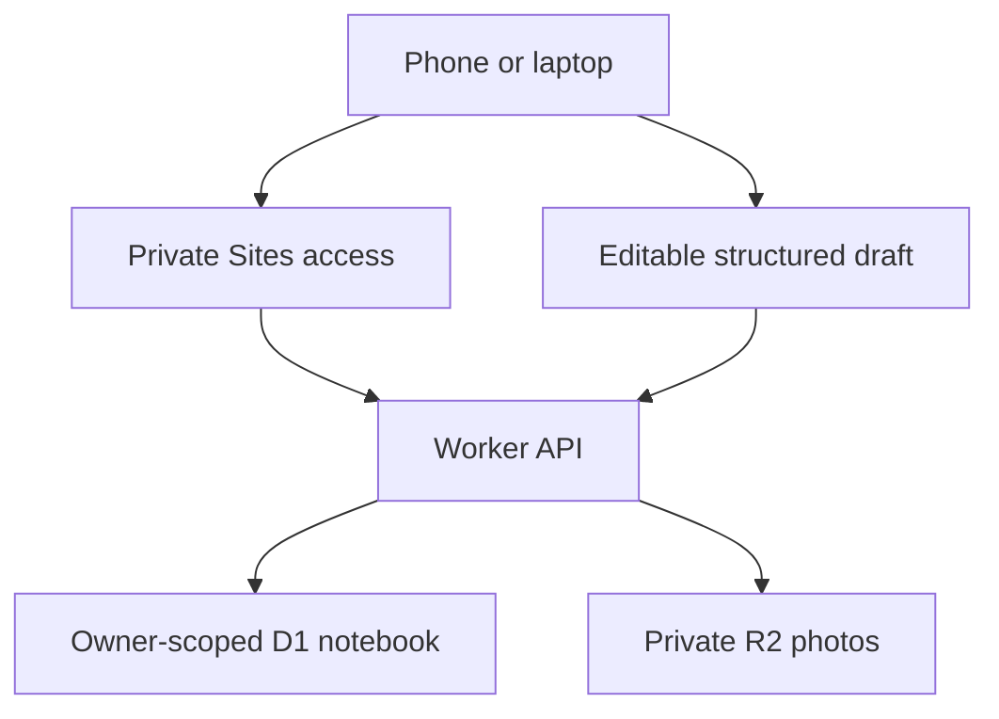

# Architecture and decisions

## ADR 1: shared persistence

Chosen: one versioned, owner-keyed JSON document in D1 with separate photo metadata and R2 objects. This allows a small first release, atomic whole-notebook writes and portability through backups. Alternatives: browser-only persistence would not synchronize devices; a fully normalized schema would increase query/migration complexity. Tradeoff: limited notebook size, account-wide conflicts and no per-recipe SQL search. Move to normalized tables when these limits matter. API code never initializes schema at runtime.

## ADR 2: multilingual ingredient presence

Keep display names unchanged; canonicalize a reviewed small dictionary plus user-defined aliases during matching. Normalize Arabic/Persian forms and zero-width spacing. Distinct ingredients remain distinct. This supports deterministic, inspectable matching without an embedding/model cost. Unknown spelling is not guessed. Alias conflicts are user-controlled; stronger conflict tooling is future work.

## ADR 3: AI bridge before paid automation

Provide an extraction prompt and strict draft importer. The owner uses a chat separately and chooses which draft to import. Original JSON and saved revisions are retained. Completeness warnings are explicitly rule-based. This keeps core data independent of models and avoids pretending a chat subscription is an API. Live provider integration, retrieval citations and accepted/rejected structured suggestions are future work.

## ADR 4: platform-owned authentication

Use private Sites access and dispatcher identity; Worker APIs enforce owner-scoped reads/writes. Avoid a homegrown password store. If moved to independent hosting, replace the identity adapter with an established verified auth mechanism before exposure. Keeping just the incoming header check without a trusted dispatcher would be insecure.
